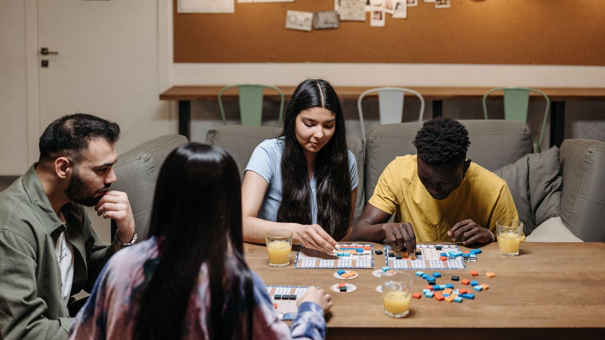
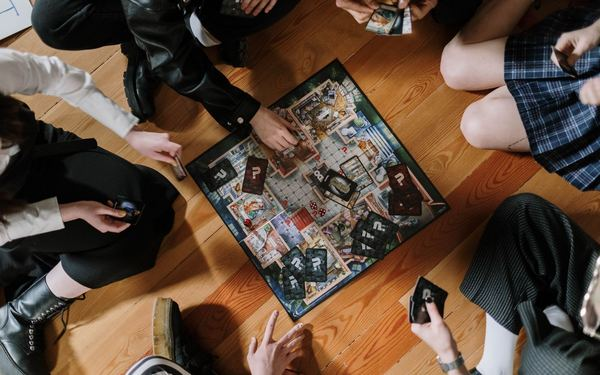

  
  

    <h1>Board games, in plain English.</h1>
    
Buy one game tonight. Play it tonight. We tell you how many players it needs, how long it takes, what age it suits, and what it costs.

    
<a class="btn" href="/finder/">Find your game</a> <a class="btn-ghost" href="/guides/best-board-games-for-beginners/">Start with beginners</a>

  

## Start here: who is playing?

  

    
    
First game

    <h3><a href="/guides/best-board-games-for-beginners/">Beginners</a></h3>
    
Never played a modern board game? Ten easy games, all learnable in about ten minutes.

  

  

    
    
Date night

    <h3><a href="/guides/best-board-games-for-couples/">Couples</a></h3>
    
Games made for two, not games that just allow two. Patchwork, Jaipur and 7 Wonders Duel lead the list.

  

  

    
    
Two players

    <h3><a href="/guides/best-board-games-for-2-players-under-40/">2 players under $40</a></h3>
    
Two-player games that are actually good with two, at a price you can plan around.

  

  <h2>Find your game in 30 seconds</h2>
  
Answer four questions: players, time, budget, type. The Finder narrows our list to the games that fit your table.

  
<a class="btn" href="/finder/">Try the Board Game Finder</a>

## How to choose your first game

1. **Count the players.** Most game nights are 2 people, or 3 to 4. A game that says "2 to 5 players" is not always good with 2.
2. **Check the time.** A 30-minute game gets played. A 3-hour game sits on the shelf. Start under 60 minutes.
3. **Learn the rules in 10 minutes.** The best first games, Ticket to Ride, Codenames, Azul, Carcassonne, Sushi Go!, are teachable in under ten minutes and finish in under an hour.
4. **Buy one, not five.** One good gateway game beats a shelf of games nobody has learned yet.

## How we pick games

We only recommend games we can describe with facts: players, time, age, and a BoardGameGeek rating where one exists. We publish a price only when we have verified it, and we date-stamp every check. Where a price is not verified, we say so, in the guide itself.

Game facts were last checked 22 Nov 2026. Prices change often, so always check the live price at the store before you buy.

## All guides


  

    
    <h3><a href="{{ post.url }}">{{ post.data.title }}</a></h3>
    
{{ post.data.description }}

    
{{ post.date | readableDate }} · Last checked {{ site.lastChecked }}

  



## A note on prices and facts

Board game prices change often, and a game's price at Amazon is not the same as at Target. We only publish a price when we have verified it, and we date-stamp every check. Where a price is not verified, we say so.

See the note at the top of each guide. Game facts (players, time, age, BoardGameGeek rating) were last checked 22 Nov 2026.
